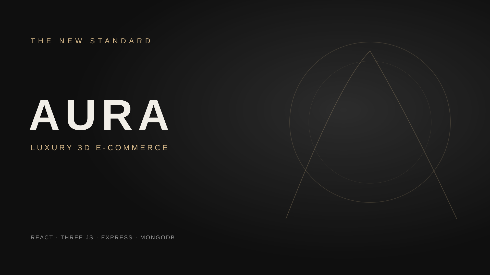

# AURA — Luxury 3D E-Commerce Platform



AURA is a premium fashion storefront built for modern streetwear brands. It combines a React shopping experience with interactive Three.js product presentation, animated UI, cart and checkout flows, and an Express/MongoDB API for inventory and orders.

## Highlights

- Interactive 3D hoodie hero built with React Three Fiber and Drei
- Responsive product catalogue with category filtering
- Product detail modal, cart drawer, quantity controls, and checkout flow
- MongoDB-backed product inventory and order processing API
- Fallback catalogue so the storefront remains viewable while the API is offline
- Admin analytics UI scaffold for inventory and sales visibility

## Tech stack

- **Frontend:** React 19, Vite, React Router, Tailwind CSS, Framer Motion, GSAP
- **3D:** Three.js, React Three Fiber, React Three Drei, GLB assets
- **Backend:** Node.js, Express 5, CORS, dotenv
- **Database:** MongoDB with Mongoose

## Project structure

```text
.
├── backend/                    # Express API, models, routes, and seed data
└── frontend/frontend/          # Vite React storefront
    ├── public/models/          # 3D GLB product assets
    └── src/components/        # Storefront UI components
```

## Getting started

### 1. Start MongoDB

Use a local MongoDB instance or provide a hosted connection string through `MONGO_URI`.

### 2. Start the backend

```bash
cd backend
npm install
npm run dev
```

The API runs on `http://localhost:5000` by default.

### 3. Start the frontend

In another terminal:

```bash
cd frontend/frontend
npm install
npm run dev
```

Open the local URL printed by Vite. The storefront requests products from `http://localhost:5000/api/products` and uses demo products if the API is unavailable.

## Useful API endpoints

| Method | Endpoint | Purpose |
| --- | --- | --- |
| `GET` | `/api/products` | List products |
| `POST` | `/api/orders` | Create an order |

## Production notes

Set `MONGO_URI` and `PORT` in `backend/.env` before deployment. The frontend currently expects the API at `http://localhost:5000`; update that URL for a hosted environment.

## License

This project is provided for demonstration and client development purposes.
